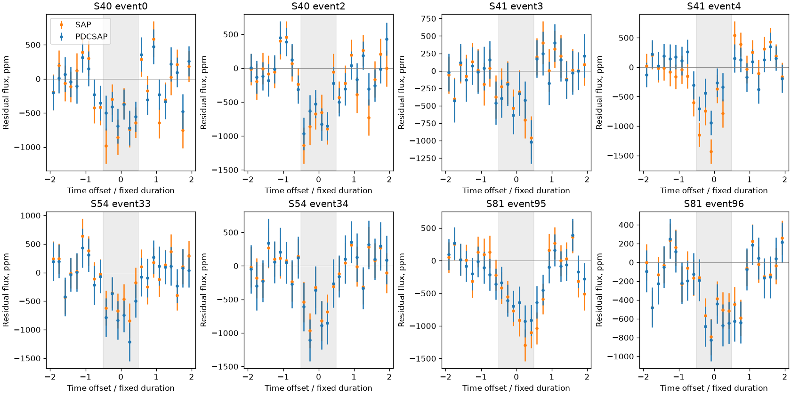

# Exoplanet search

We identified six possible exoplanet signals by searching public data from NASA’s TESS telescope for repeated dips in starlight. This repository contains the code, measurements and checks behind those findings.

Our strongest leads are **TIC 80387959** and **TIC 402358350**. Their repeated dimming survives several tests, but we still need to establish which star is dimming and why. **None of the six signals is a confirmed planet.**

## What we found

The table lists the six remaining leads, ordered by follow-up priority. TIC numbers identify stars in the TESS Input Catalog. The periods describe the repeating patterns we investigated.

| Star | Repeat interval | Evidence so far | Main unanswered question |
|---|---:|---|---|
| **TIC 80387959** | 4.19217 days | Dips return at predicted times in two later datasets and remain visible across six datasets. | Which star is dimming, and why does the measured depth change? |
| **TIC 402358350** | About 11.76954 days | Eight dips remain visible across twelve ways of estimating the surrounding brightness. | Which star is dimming, and can we predict future events accurately enough? |
| **TIC 241928959** | About 3.533 days | [Five dips remain when any one event is left out](results/event-baseline-six-20261012/ASSESSMENT.md). | Is this a planet, a stellar companion or a blend? A separate observing epoch is still missing. |
| **TIC 469309982** | About 2.8905 days | [Some tests retain the pattern, but later observations give weak or mixed results](results/reliability-469309982-20261012/ASSESSMENT.md). | Is the pattern repeatable, and which star produces it? |
| **TIC 96166003** | About 0.955 days | [A dip appears in one later dataset, but depends on the timing model](results/new-epochs-469309982-96166003-20261012/ASSESSMENT.md). | Does the signal repeat reliably, or come from a neighboring star? |
| **TIC 5546257** | 1.76729 days | [Dimming in a nearby eclipsing star strengthens the case for contamination](results/extension-402358350-5546257-20261012/ASSESSMENT.md). | Can that neighbor fully explain the selected pattern and its apparent period? |

These are our research assessments, not official catalog classifications. We have not established that any signal is a new discovery. The [evidence index](CHECKED-RESULTS.md) records the full investigation, including leads we rejected and checks that failed. Results were last reviewed on **13 October 2026**.

## Evidence for the strongest leads

### TIC 80387959: dimming returns at the predicted times

We predicted when the star should dim using earlier observations, then checked two later TESS datasets without adjusting the prediction. Both show dips of roughly **0.06%** at the expected times: the clearest successful prediction test in the search. [Prediction and measurements](results/followup-80387959-qlp90-100-20261009/heldout.json).

The dips remain visible across six datasets when we change how we estimate the surrounding brightness or leave individual events out. The pattern does not depend on one dip or our original smoothing method. [Measurements, plots and verification](results/strongest-80387959-shape-20261012/ASSESSMENT.md).

Nearby stars contribute light to the same measurement, and image models disagree about which star is responsible. The measured depths also differ between older and newer data; processing differences and noise could explain this. [Source tests](results/prf-80387959-event-stability-20261011/ASSESSMENT.md) · [Noise and contamination review](results/refereed-vetting-20261012/ASSESSMENT.md).

### TIC 402358350: eight dips survive different analysis choices

All eight usable dips remain visible across **twelve analysis choices**, with combined dimming of about **0.059–0.066%**. They appear in both the original brightness measurements and the telescope team’s corrected version, without our running-median smoothing. Leaving out any single event preserves the combined dip. [Full analysis and verification](results/strongest-402358350-baselines-20261012/ASSESSMENT.md).



Each panel shows one event. The gray band marks the expected dip; orange and blue show two reductions of the same observations, so they are not independent confirmations. Error bars describe the measurement model and do not include every timing, instrumental or source uncertainty.

This supports a recurring dip, but its timing remains too uncertain to pass our stricter prediction test. Nearby stars and stellar variability also remain possible explanations. One comparison window in the original brightness data contains an even deeper dip, and some other comparisons lack adequate coverage; those unfavorable results are retained. [Timing test](results/heldout-402358350-s81-20261011/ASSESSMENT.md) · [Alternative explanations](results/extension-402358350-5546257-20261012/ASSESSMENT.md).

## How we searched

1. Select stars with suitable public TESS observations.
2. Remove slow brightness trends and search for repeating dips using box least squares, a method that tests the timing and length of possible transits.
3. Check individual events, processing choices and noise controls. Record predictions before testing reserved observations.
4. Inspect neighboring stars, catalogs and literature for other explanations, retaining failed tests alongside favorable results.

The largest search attempted **7,004 targets** and reviewed all **28** initial screening passes. Other searches revisited 689 targets with more observations and examined fainter stars in a 100-star pilot and 1,845-star expansion. The samples overlap; their counts cannot be added into a total of unique stars. [Full accounting, data errors and limitations](results/scoped-completion-20261012/ASSESSMENT.md).

This search can miss planets. In one small test using three selected quiet stars, it recovered only 3 of 18 artificial signals with 0.01% dips. That test measures performance in those examples, not the completeness of the survey. [Injection and recovery results](results/solar-radius-shallow-injections-20261011/ASSESSMENT.md).

## What would settle the candidates?

We need observations that measure the targets and their neighbors separately throughout a predicted dip, plus stronger checks for hidden stellar companions. Our image methods fail some known-planet controls, so their preferred star is not enough to identify the source. Until that is resolved, we cannot reliably estimate a planet’s size.

We also tested both leads with **TRICERATOPS**, which compares planet and stellar-eclipse explanations. Neither passed its published validation thresholds. The model omits instrumental effects and general stellar variability, and the million-draw runs have not been repeated with different random seeds. Its percentages cannot be read as reliable odds that we found planets. [Results and limits](results/triceratops-20261013/ASSESSMENT.md).

The planned searches are complete. Further archival checks and observing plans have not yet supplied decisive evidence, and no telescope time is secured. [Follow-up evidence](results/followup-overview-20261013/ASSESSMENT.md) · [Current objective and next steps](GOAL.md).

## Explore the results or run the code

Start with the [local evidence explorer](dashboard/README.md) for interactive light curves and comparisons. Each saved experiment links its assessment to measurements, data sources and verification. The [results guide](results/README.md) explains the layout.

To install the search tools, use Python 3.12 and `uv`:

```sh
uv sync --locked --python 3.12
uv run pytest
uv run exoplanet-search --help
```

The algorithms live in [src/exoplanet/](src/exoplanet/) and their tests in [tests/](tests/). See the [code and workflow guide](CODE-ORGANIZATION.md) for other commands. Before downloading new observations, follow its [data-access preflight](CODE-ORGANIZATION.md#before-opening-additional-observations): the generic follow-up command automatically opens reserved data. Previously inspected observations cannot become fresh blind tests.

Experiments retain their original plans, data sources and checks. The [evidence index](CHECKED-RESULTS.md) and [historical notes](README-HISTORY.md) preserve earlier interpretations and why they changed.

## Data and repository status

This work uses [NASA TESS](https://heasarc.gsfc.nasa.gov/docs/tess/data-products.html), [TESS-SPOC/MAST](https://archive.stsci.edu/hlsp/tess-spoc) and other surveys credited in each experiment. The [HD 32564 radial-velocity analysis](results/rv-hd32564-20261010/ASSESSMENT.md) reproduces an external lead and is separate from the TESS candidate search.

Sensitive operational details have been removed from the publication snapshot; see the [release audit](docs/RELEASE-AUDIT.md). Original code and documentation use the [MIT license](LICENSE); [survey data and third-party material retain their own terms](docs/DATA-SOURCES.md). No candidate has been submitted or announced as a discovery.
