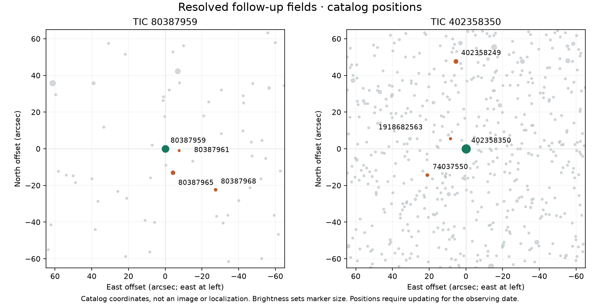

# Resolved-source follow-up

This extension checks previously untested competing stars and prepares prospective observations from the existing timing evidence. It does not repeat the failed TESS source-localization methods or reopen the completed search queues. Both target signals remain unresolved.

## New archival tests

- [TIC 80387968 / SkyMapper](../resolved-followup-803-20261013/ASSESSMENT.md): 43 of 47 measurements pass strict quality cuts. Two points show no dimming within one predicted event. This weakens the specific same-depth, flat-bottom eclipse hypothesis but fails the two-event clearance requirement; color, shape and calibration uncertainties remain.
- [TIC 74037550 / ZTF](../resolved-followup-402-20261013/ASSESSMENT.md): six securely associated streams contain 836 measurements; 545 pass quality cuts. All 72 fixed-clock/time-convention/stream-or-filter comparisons are inconclusive. The timing and coverage gates prevent an eclipse detection or exclusion. A failed TAP query is retained separately from the successful cloud retrieval.

These tests concern particular neighboring-star explanations. Clearing one neighbor would not establish the named target as the host or establish a planet. No calibrated probability update is available.

## Observation preparation

The [planning packet](../followup-planning-20261013/ASSESSMENT.md) propagates the preserved period/epoch profiles without refitting the light curves. Its envelopes are heuristic sensitivity ranges, not confidence intervals. The machine-readable [event list](../followup-planning-20261013/events.csv) is a site-independent planning aid, not a telescope schedule; daylight, altitude, season, weather and instrument sensitivity have not been evaluated.

A useful new observation would measure the target and competing sources separately throughout the allowed dip window, with out-of-event reference measurements. Resolve the relevant neighbors, maintain adequate precision and avoid saturated target images. Establish actual sensitivity through comparison stars and injection/recovery or an equivalent documented test. If timing, coverage or precision is inadequate, a flat neighbor light curve is inconclusive.

- **TIC 80387959:** the preserved timing profiles allow a roughly 5.6-hour track, including the event window and one hour of baseline on each side. This is the priority for a site-specific feasibility check.
- **TIC 402358350:** the expanded-clock sensitivity requires roughly 17.5–18.5 hours, with much broader disagreement in the earlier discovery profiles. Recovering the timing comes before a short targeted transit observation. A single normal night could miss the event and cannot clear its neighbors.

This strategy follows the TESS Follow-up Observing Program's use of resolved, seeing-limited photometry to investigate neighboring eclipsing binaries. [Official TFOP description](https://tess.mit.edu/followup/). The reference page is retained with URL, retrieval time and hash in [sources.json](sources.json).

## Field diagrams

Green marks each target; orange marks selected competing stars. These diagrams use the retained, deduplicated TIC catalog coordinates and nominal TESS magnitudes. They are not telescope images, new astrometric measurements or source localizations. The planning packet supplies approximate proper-motion updates for observing preparation. Marker size indicates brightness, not stellar size. Other faint catalog sources remain visible; the highlighted set is not an exhaustive false-positive inventory.

[Catalog coordinates](field-coordinates.json), [input hashes](field-provenance.json), and [independent geometry verification](field-verification.json) retain the chart provenance. The scalar spherical calculation reproduces all 24 offset/separation values and verifies both catalog hashes.

No telescope was booked, observer contacted, candidate submitted or new planetary status assigned.

## Verification

The new SkyMapper experiment passes 219 offline checks. The ZTF experiment
passes 23 metadata and 563 photometry checks, with a separate
[498-check review](../followup-planning-20261013/402-review.md) reproducing its
weighted fits and failed timing gates. The planning packet passes 709 checks
and a separate [214-check review](../resolved-followup-803-20261013/planning-review.md).
These establish reproducibility and arithmetic, not source attribution or
planetary status. Shared scientific algorithms were unchanged.
