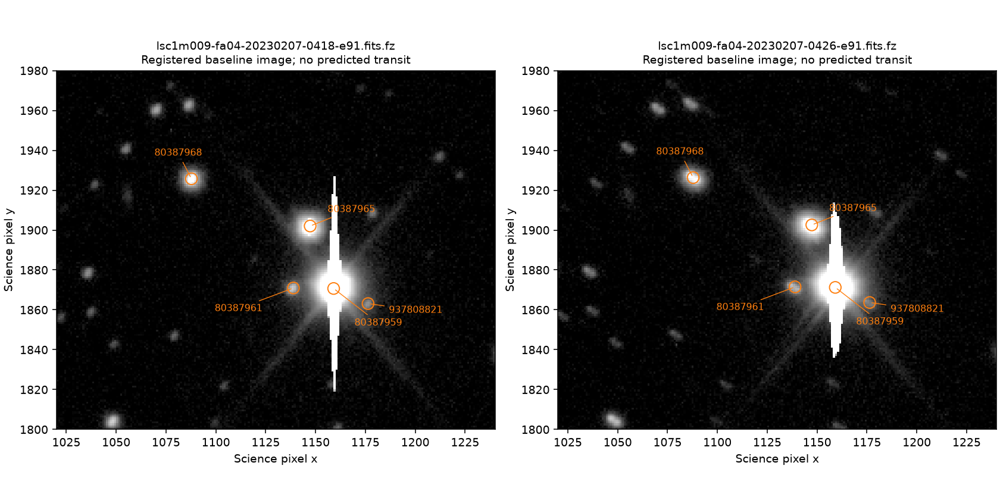

# LCO archival coverage and baseline-image feasibility

**No discriminating transit or target spectrum was identified.** TIC 80387959 has nine public science images in the queried footprint, but they precede the predicted dip. Two authorized baseline images show saturated cores at both the primary and principal neighboring star. TIC 402358350's returned spectroscopy is associated with a different star and erroneous, very broad spectral-image footprints. Neither candidate's planetary classification changes.

## Public metadata search

The [official archive guide](https://lco.global/documentation/archive-documentation/) distinguishes sky-position searches from OBJECT-name searches. We used the [documented API](https://developers.lco.global/#list-frames) `covers=POINT(RA DEC)` filter, anonymously, with `public=true`, dates from 1900-01-01 through 2026-10-13 23:27:41 UTC, and no instrument, observing-type or reduction-level restriction. Queries at the retained J2016 coordinates and approximate proper-motion J2027 coordinates returned the same source-specific sets. This tests public indexed footprints at those positions, not proprietary data, unknown footprints, nearby-only coverage, or physical detector usability.

| Target | Retrieved metadata per coordinate query | Assessment |
|---|---:|---|
| TIC 80387959 | 55 distinct records | Nine science EXPOSE images and 46 autofocus engineering records |
| TIC 402358350 | 1,095 rows / 1,094 unique IDs | Spectra/images of HD 182572 with misleading footprints; other rows are calibration or engineering records |

The first four requests failed: anonymous access rejects a page limit of 1,000. Retrying at 100 succeeded. The service returned `count=1`, `count_estimated=true`, and `next=null` even with a full 100-row page. Explicit offsets were therefore requested until an empty page: offset 100 for 80387959 and 1100 for 402358350. The initial `retry-summary.json` status based on `next=null` is superseded by [paginated-summary.json](paginated-summary.json). One repeated ID in the 402358350 response indicates unstable pagination; exact completeness is not asserted, even though the terminal page is empty. All errors, responses and query amendments remain retained.

## TIC 80387959: nine exposures outside the dip

The nine distinct reduced images were acquired on 8 February 2023 with the LSC 1-m Sinistro camera fa04, in the wide `w` filter. Each exposure lasted 240 seconds; their combined time span was 06:45:08.626–07:24:43.136 UTC, approximately 39.6 minutes. Their OBJECT keyword is `A10SuBN`; positional coverage, rather than the unrelated name, identifies this field.

The original frozen period/epoch, all five stored profile pairs, three heuristic epoch floors and the full dip duration were propagated without refitting. Exposure endpoints lie 3.84–3.18 hours before the nominal midpoint. None intersects the expanded dip envelope. All 46 autofocus records also miss the envelope and were not downloaded. [Timing calculation](803-timing.json).

The conversion uses geocentric BJD_TDB with Astropy's bundled solar-system ephemeris. Omitting the site correction contributes at most about 21 milliseconds, immaterial to the hours-wide separation. Timing profiles remain heuristic, not confidence intervals. These images cannot supply an in-event non-detection or source attribution.

## Two baseline images: saturation prevents the proposed extraction check

A [separate plan](image-plan.json), with [SHA-256 record](image-plan.sha256), preceded download of only the first and last science frames. Both files are about 40 MB. The plan permits geometry, saturation, masks and spatial-resolution assessment; it does not permit transit fitting or inference from two-point photometric precision.

The FITS header WCS alone misplaces local catalog sources by several arcseconds. Its naive nearest-source measurements in [image-feasibility.json](image-feasibility.json) are retained as a failed identification step and must not be used to assign widths or saturation to specific stars. A local affine registration against the previously cached TIC scene uses 44 and 48 matched stars. Withholding every third consensus match gives 15 and 16 registration checks with RMS residuals of 0.24 and 0.13 arcsec, respectively. The global translation and consensus selection use all matching stars before the split, so these residuals are diagnostic astrometry rather than a blind independent validation. They are not planetary holdouts.

| Source | First / last image | Consequence |
|---|---|---|
| TIC 80387959 | 104 / 111 pixels exceed the saturation header threshold in a 6-pixel-radius aperture; 107 / 111 pixels masked | Core photometry fails the planned ordinary extraction check |
| TIC 80387965 | 20 / 18 pixels exceed saturation; 24 / 24 pixels masked | Principal contaminating neighbor also fails that check |
| TIC 80387968 | No saturation or masked aperture pixels; catalog FWHM 1.94 / 2.59 arcsec | Spatially resolved baseline source, but no event coverage or demonstrated dip sensitivity |

The planning catalog gives a primary-to-principal-neighbor separation of 13.8 arcsec. The mixed-epoch coordinates drawn here (Gaia J2016 for the primary, retained TIC coordinates for the neighbor) give approximately 13.03 arcsec, or 33.47 pixels at the 0.389 arcsec/pixel scale. Neither is a new astrometric separation measurement; the coordinate-epoch difference must be resolved for precise observing setup. Their locations are spatially distinct, but saturation and bleeding prevent using these long exposures to certify precise extraction. Nearest unsaturated-catalog matches far from saturated sources are unrelated detections; their reported widths are not widths of the saturated stars. A special saturated-wing method was not attempted or validated.

[Registered measurements](registered-feasibility.json) retain the transform, residuals and aperture counts. These results concern this camera and these 240-second exposures. They do not establish the performance of shorter exposures or a future assigned instrument. No additional image is needed to resolve the present baseline-feasibility question; the other seven science images remain unopened.

## TIC 402358350: footprint matches are not spectroscopy of the candidate

The returned records contain 624 SPECTRUM rows, four EXPOSE rows, and calibration/engineering products. Their science OBJECT is `HD 182572`; raw/reduced versions share observing times. Representative spectrum and image headers point 5.293 degrees from TIC 402358350. The `en03` records carry a 0.0275-degree/pixel sky WCS and polygons spanning tens of degrees, which cannot establish that the candidate entered a spectrograph slit. Representative [headers](headers-metadata.json) were retrieved as metadata only. No spectrum or 402358350 image was downloaded, and no radial-velocity or transit conclusion follows.

## Reproducibility and next dependency

[Sources](sources.json) records URLs, retrieval times and raw SHA-256 hashes. Query scripts preserve failed and corrected requests; raw bodies and the two images remain in ignored `data/lco-archive-metadata-20261013/`. [Verification](verification.json) checks retained hashes, pagination, matching query sets, time-window arithmetic and saturation/mask counts. It does not establish astrophysical validation or exhaustive archive completeness. A separate [independent review](../site-visibility-20261013/LCO-REVIEW.md) reproduces all ten saturation/mask aperture counts, all 55 timing classifications, the site timing correction and the misleading spectral-footprint geometry.

The useful next observation remains resolved photometry with suitable exposure times, verified precision and full timing coverage. These archival frames provide concrete evidence against reusing the particular 240-second wide-filter settings for ordinary primary/principal-neighbor core photometry. Access to an appropriate instrument and an independently registered observing experiment remain necessary. No observer was contacted, booking made, or candidate submitted.
