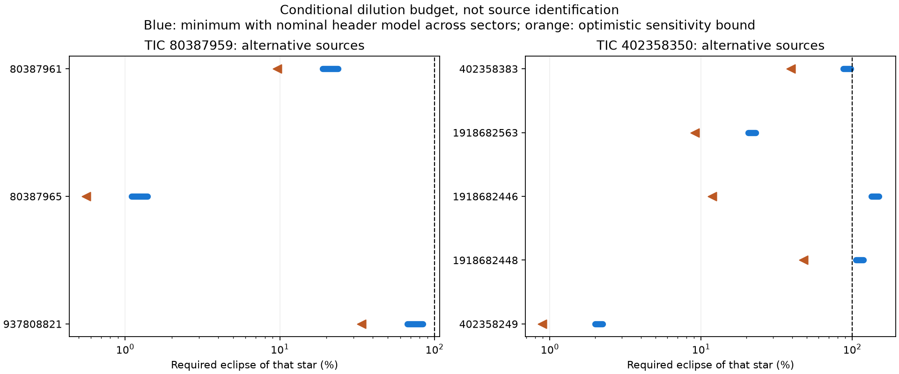

# Paper-guided nearby-source dilution audit

**The principal neighboring hosts remain physically possible under at least one declared flux model. Neither signal is promoted.** We applied the neighborhood-brightness screening step in Giacalone et al. (2022, AJ 163:99), using actual aperture flux rather than treating corrected depths as diluted aperture measurements. This supplies quantitative eclipse requirements and priorities for resolved follow-up; it is not a TRICERATOPS run or a numerical false-positive probability.

## What was measured

The preserved clocks (original 80387959 clock and expanded pre-sector-81 clock for 402358350) and already-opened SAP observations were used, with a shared exposure-integrated box and separate linear local baselines for each event. Periods, epochs and durations were unchanged. Four sectors per target have positive dips. No new observations, high-resolution imaging or source-localization fits were obtained.

| TIC | Sector | SAP depth (ppm) |
|---|---|---|
| 80387959 | 10 | 759 ± 104 |
| 80387959 | 36 | 688 ± 83 |
| 80387959 | 37 | 801 ± 80 |
| 80387959 | 63 | 843 ± 81 |
| 402358350 | 40 | 669 ± 88 |
| 402358350 | 41 | 706 ± 84 |
| 402358350 | 54 | 582 ± 84 |
| 402358350 | 81 | 622 ± 70 |

Errors use the linear model's residual-scaled covariance; they do not cover all correlated noise, uncertain ephemerides or systematic baseline errors. Native SAP is divided by its sector median; the shared decrement is then divided by the mean fitted event baseline, with covariance propagated. Median time spacing approximates integration. Declared per-event coverage failures, including the sector-40 gap, are retained. These fits are a consistency input, not independent detections beyond earlier baseline tests.

## Required eclipses for important competing hosts

These are **conditional requirements, not inferred eclipse depths**. A 100% eclipse is the most generous possible complete removal of that catalog source's flux; many real binaries cannot reach it. The minimum assumes all of the neighbor's total flux could enter the aperture, while respecting the nominal total contaminant budget. The equal-throughput column assumes the same fraction of target and neighbor flux enters the aperture. The optimistic column combines a shallower dip, brighter neighbor and perturbed header model as described below; it is a conservative lower bound, not a confidence limit or a physically fitted configuration.

| Target TIC | Alternative TIC | Separation (arcsec) | Nominal minimum, sectors | Equal-throughput requirement | Optimistic lower bound |
|---|---|---|---|---|---|
| 80387959 | 80387961 | 7.54 | 18.86–23.85% | 24.19–29.47% | 9.59% |
| 80387959 | 80387965 | 13.76 | 1.10–1.39% | 1.41–1.72% | 0.56% |
| 80387959 | 937808821 | 7.39 | 66.64–84.27% | 85.48–104.15% | 33.80% |
| 402358350 | 402358383 | 17.35 | 87.34–97.90% | 105.01–122.41% | 39.26% |
| 402358350 | 1918682563 | 10.12 | 20.59–23.08% | 24.76–28.86% | 9.13% |
| 402358350 | 1918682446 | 5.24 | 134.24–150.46% | 161.39–188.12% | 11.82% |
| 402358350 | 1918682448 | 8.41 | 105.53–118.29% | 126.88–147.90% | 47.60% |
| 402358350 | 402358249 | 48.11 | 2.00–2.24% | 2.40–2.80% | 0.89% |

TIC 80387965 could mimic the first signal with an approximately 1–2% eclipse under these assumptions. TIC 80387961 needs a substantially deeper event, and TIC 937808821 is near a total-eclipse requirement. For TIC 402358350, neighbor 1918682563 needs a deep eclipse; 402358383 requires almost complete loss of its light under the nominal optimistic-throughput model. Several nominal faint-source requirements exceed 100%, but plausible depth/model/magnitude sensitivity reopens the listed close alternatives. **None of these listed competitors is safely cleared.** The known pulsator 402358249 also has sufficient brightness in principle; this does not establish that its variability produces the selected period.

## Derivation and all-source audit

Let `d` be the SAP fractional dip, `c` the target's modeled fraction of aperture light (CROWDSAP), `eta` its modeled captured fraction (FLFRCSAP), `r = 10^(-0.4 ΔTmag)` the neighbor/target total T-band flux ratio, and `q` their captured-fraction ratio. A neighbor eclipse of fractional depth `e` produces `d = e c r q`. Thus `e = d/(c r q)`. For a neighbor, `q <= 1/eta`; it must also satisfy `c r q <= 1-c`, because a single neighbor cannot exceed the entire modeled contaminant flux. The target is handled separately with `r=q=1`.

The frozen plan stated the physical throughput bound. The implementation additionally records the contaminant-budget bound, a direct consequence of the same nonnegative scene accounting; this only tightens the nominal conditional screen, not a new acceptance criterion. Each catalog row is evaluated individually as an alternative. No sum assumes all catalog entries are distinct physical stars.

[results.json](results.json) retains every cached TIC row within 150 arcsec: **348 rows around 80387959 and 2,289 around 402358350**, each across four sectors (10,548 source-sector cases). All have nominal T magnitudes and reported errors. The cached cones are broader than the 150-arcsec selection. Row counts are catalog records, not guaranteed distinct stars. TIC disposition and duplicate fields are preserved. Positions use the saved catalog coordinates; they are not a new proper-motion-corrected imaging measurement. Every source has `q=0.25, 0.5, 1, 1/eta` alternatives, with physically inconsistent points explicitly flagged. Brightness sufficiency is not evidence the aperture actually captures enough of an off-axis star.

For sensitivity we use `max(0,d-3 sigma_d)`, a brighter neighbor by three quadrature catalog magnitude errors, target throughput reduced by 10%, and crowding fraction increased by 10% (clipped to physical limits). These 10% perturbations are arbitrary declared stress tests, not measured uncertainty intervals. The resulting optimistic lower bound allows these factors separately and intentionally does not impose simultaneous attainability or the full contaminant budget. Small formal magnitude errors cannot cover catalog mistakes, variability, spurious entries or wrong identity. No row is removed from future host models on this audit alone.

The earlier [Gaia scene audit](../gaia-402358350-scene-20261011/ASSESSMENT.md) found ambiguous DR2–DR3 alternatives for 402358383, 1918682446 and 1918682448; 1918682446 has no returned same-ID DR3 match and a 0.6-mag T uncertainty. These are especially poor grounds for categorical brightness exclusion. CROWDSAP and FLFRCSAP are pipeline models, not independently measured response functions, and can be wrong in a blended or incomplete scene. The method does not constrain unresolved companions or uncataloged stars.

## Relation to the refereed workflow

Giacalone et al. (2022), §III, assesses whether neighboring stars can supply sufficient aperture flux, then combines pixel vetting, stellar characterization, resolved time-series photometry, contrast curves and probabilistic scenario modeling. We implemented the feasible brightness-budget component, exposing the unknown aperture response rather than substituting a failed PRF fit. Their use of aperture flux is material here: using corrected depths as uncorrected SAP would distort the dilution calculation. [Paper](https://arxiv.org/html/2201.12661)

The next discriminating measurement would resolve the event on the target or exclude events of the required depth on these specific neighbors, with a calibrated response/dilution model. A successful shallow known-host spatial control is required before treating our own pixels as such a measurement. This calculation cannot substitute for those observations and does not justify validation or publication as a discovered planet.

## Reproducibility

[plan.json](plan.json) was frozen before calculations. [provenance.json](provenance.json) retains raw light-curve URLs/hashes, catalog request provenance and the paper URL/hash; raw downloaded paper remains in ignored data. Eight compressed fit records preserve cadence arrays/designs/covariances. [verify.py](verify.py) independently reconstructs native masks, event selection and regression; uses nuisance-projected transit estimates; checks direct photon-accounting equations for every source-sector case; and recovers deterministic synthetic flux decrements. [verification.json](verification.json) records 168,863 passing checks. This verifies implementation arithmetic, not astrophysical model validity. Run `uv run python results/paper-host-vetting-20261012/verify.py`.
