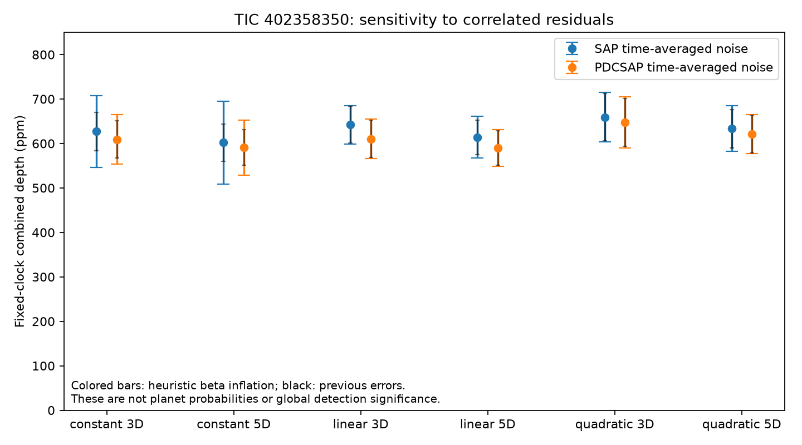

# TIC 402358350: correlated-noise sensitivity

**The fixed-clock dimming remains positive under a literature-based time-averaging check, but some baseline choices substantially understate uncertainty if correlations are ignored.** Across all twelve methods, the original combined depths are 590–659 ppm; heuristic correlation-inflated uncertainties are 41–93 ppm, compared with 39–54 ppm previously. This does not resolve the host or the earlier timing failure.

## Method taken from refereed work

[Pont, Zucker & Queloz (2006), MNRAS 373, 231](https://doi.org/10.1111/j.1365-2966.2006.11012.x), particularly section 2.6, estimates correlated noise from the scatter of averages outside transits. Adjacent measurements need not contribute independent information; noise should be examined on the duration of the signal. We adapt that principle to the already-saved local baseline windows.

[Petrucci et al. (2015), MNRAS 446, 1389](https://doi.org/10.1093/mnras/stu2152), the WASP-28 transit study, uses the ratio beta of binned residual scatter to its white-noise expectation. Its equation 5 supplies the finite-bin correction: expected scatter is sigma1 / sqrt(N) times sqrt(M/(M−1)). Our application uses population standard deviations, equally populated bins, and excludes the event from noise estimation. It is a sensitivity test, not a reproduction of that paper's physical parameter inference.

The [frozen plan](plan.json) precedes computation. It retains all SAP/PDCSAP fits, polynomial degrees 0/1/2 and outer radii 3D/5D from the [previous baseline experiment](../strongest-402358350-baselines-20261012/ASSESSMENT.md). The unchanged duration is D=0.144 day. Each weighted baseline is refitted only outside ±D. Contiguous residual segments are split at excluded samples or gaps larger than 1.5 median cadences. Full nonoverlapping bins use durations near 0.25D, 0.5D and D, with two declared bin origins. Segments never cross events or sectors. Each estimate requires at least four bins; 78 of 576 binning cases are unavailable and retained.

For each event, beta is the maximum of 1 and all available bin ratios. We multiply its existing scatter-scaled depth error, including baseline uncertainty, by beta. Combined depths retain their original weights; inflated errors propagate those weights. A separate reweighted sensitivity is also retained. This deliberately simple scalar inflation is not a complete covariance model or a calibrated confidence interval.

## Results

Depths below retain the original weights. Each uncertainty uses the new heuristic inflation.

| Baseline | SAP depth, ppm | PDCSAP depth, ppm |
|---|---:|---:|
| Constant, 3D | 627 ±80 | 609 ±56 |
| Constant, 5D | 602 ±93 | 591 ±62 |
| Linear, 3D | 642 ±43 | 610 ±44 |
| Linear, 5D | 614 ±47 | 590 ±41 |
| Quadratic, 3D | 659 ±56 | 647 ±57 |
| Quadratic, 5D | 633 ±51 | 621 ±44 |

All eight usable events remain included and positive in every method. The gap event in sector 40 remains insufficient in all twelve methods. Event beta factors span 1–4.65; the greatest error inflation occurs with the constant 5D SAP baseline, which cannot remove local slopes. The illustrative linear 3D fits change little: SAP 642 ±41 becomes ±43 ppm; PDCSAP 610 ±42 becomes ±44 ppm. Reweighting by the inflated errors shifts the combined depths to 564–644 ppm across methods; those exploratory sensitivity values remain in [results.json](results.json).

## Verification and limits

The [independent verifier](verify.py) passes **1,484 checks**: input hashes, an independent normal-equation solution versus the experiment's least-squares solution, every segment/bin and beta calculation, coverage accounting, and all fixed-weight combined measurements. Deterministic [synthetic tests](test_experiment.py) pass for white versus correlated AR(1) residuals, gap/mask boundaries, and signed ±600 ppm injection transfer with baseline refitting. The figure was visually inspected. The verifier starts from previously verified saved arrays; it does not independently download or reconstruct the raw telescope calibration.

Local windows supply few duration-length bins. Polynomial fitting itself removes slow noise, and taking a maximum beta across a small grid does not ensure conservative coverage for every unknown process. Correlations between different events are not modeled. Event selection and clock discovery remain conditioned on the original search, so dividing a depth by these errors is not a search false-alarm probability. SAP and PDCSAP share exposures and cannot be counted as independent detections. No planet probability, host assignment, timing revision, or new observing epoch follows from this check.

Paper downloads and failed access are recorded in [sources.json](sources.json). The journal HTML request returned 403; its author preprint was then downloaded successfully from arXiv. Original responses remain in ignored `data/` with SHA-256 hashes. No failed source access was interpreted as missing scientific evidence.
